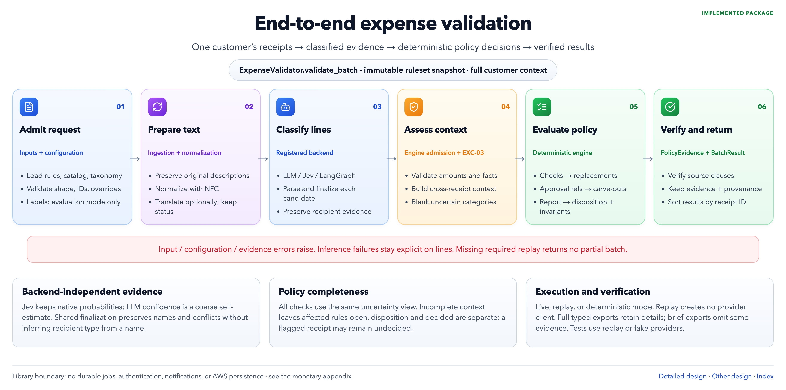
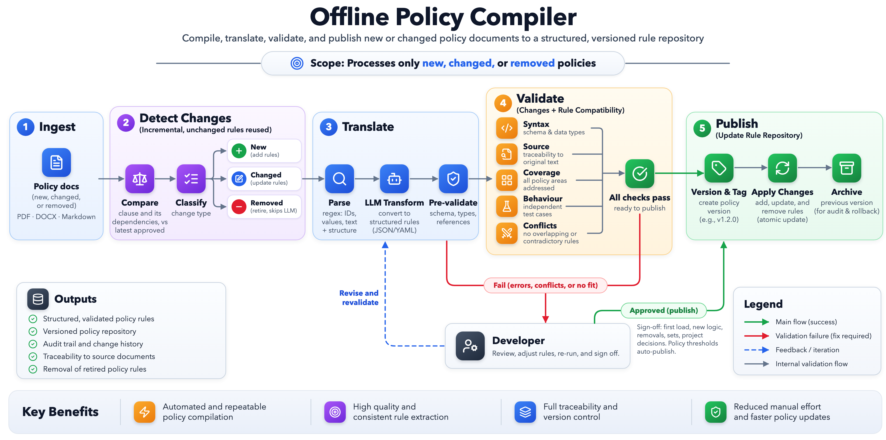

# Using the Expense Policy Validator

Setup, package usage and the REST API. The project's design is in the [README](../README.md).

Classifies expense receipt lines, applies deterministic policy rules, and returns `pass`, `review`, or `flag` with evidence. One company shares versioned policies; employee country and entity select regional overrides. Submit all relevant receipts together: context completeness defaults to true, and no historical receipts are fetched.

## Quick start

Run from the repository root. Requires Python 3.12+; Docker Compose for the full application, Node.js 22+ for frontend development.

```sh
python3.12 -m venv .venv
.venv/bin/python -m pip install -e '.[dev]'

# Offline end-to-end run: recorded answers, no API key or paid calls.
.venv/bin/python -m expense_validator.run_receipts \
  --replay evaluation/final/replay --out /tmp/expense-receipts.jsonl
.venv/bin/python -m pytest -q

# API, worker, MongoDB, and frontend; live inference is off by default.
docker compose up --build -d
```

Open the [frontend](http://localhost:3000), [Swagger UI](http://localhost:8000/docs), or [OpenAPI schema](http://localhost:8000/openapi.json). A fresh database has no published rulesets: follow the replay-only [API demo](../backend/README.md#end-to-end-demo) or run `bash backend/demo/evaluations.sh` with `curl` and `jq` installed. The script publishes a ruleset, uploads datasets, and runs replay evaluations; it writes working files in the current directory.

For local backend development, install both packages together; the core is not fetched from a package index:

```sh
python3.12 -m venv backend/.venv
backend/.venv/bin/python -m pip install -e '.[dev]' -e './backend[dev]'
bash backend/test.sh -q  # includes real MongoDB tests; starts and removes a disposable Docker container

cd frontend
npm ci
npm run dev             # http://localhost:5173; proxies /api to the backend
npm run typecheck
npm test
npm run build
```

See [backend setup](../backend/README.md), [frontend setup](../frontend/README.md), and [existing-database migration](../backend/SINGLE_COMPANY_MIGRATION.md).

## Architecture

The existing diagrams are in `design/`; this checkout has no `architecture/` directory.



[Interactive diagram](../design/expense_validation.html) · [Validation design](../design/expense_validation.md)



[Interactive diagram](../design/offline_policy_compiler.html) · [Compilation design](../design/policy_compilation.md). The compilation diagram includes target architecture; its companion document distinguishes implemented and planned capabilities.

```text
Policy documents + handwritten rule logic → extract → review → approve → publish
                                                                         ↓
Receipts → ingest → normalize/translate → classify → deterministic rules → findings/disposition
                                                                         ↓
Frontend → FastAPI → services → core library                         stored runs
                        ↕                                                ↕
                      MongoDB ← worker ← queued dataset evaluations ──────┘
```

| Component | Responsibility and connections |
|---|---|
| Ingestion (`ingestion/`) | Validates raw records/JSONL; separates labels and notes from runtime inputs. |
| Normalization/translation (`normalization/`) | Cleans line text deterministically; optionally translates non-English text while retaining originals. Translation is separate from classification. |
| Classification (`classification/`) | Produces category, confidence, and stated attributes. Neither the LLM nor Jev decides policy or disposition. |
| Orchestration | Direct runs one adapter per line. LangGraph routes between adapters on errors/low confidence; optional bounded reflection reviews classifications, not policy. |
| Policy engine (`engine/`) | Builds facts and uncertainty views; evaluates checks and cross-receipt helpers; resolves replacements, references, and carve-outs; groups evidence and computes disposition. |
| Rule management (`policy/`, `compiler/`, `PolicyCompiler`) | Combines nine source policies with developer-authored predicates, validates candidates, reconciles independent readings, and gates publication on review/approval hashes. |
| Evaluation (`evaluation/`) | Scores predictions and rule outputs against separate reference answers; reports classification, exception, disposition, coverage, and uncertainty metrics. |
| FastAPI (`backend/src/expense_api/`) | Typed REST contracts, synchronous validation, document/ruleset lifecycle, history, exports, and queued evaluations. Calls the core library. |
| Worker and MongoDB | Workers atomically claim jobs; MongoDB persists immutable document/dataset/ruleset versions, results, lifecycle events, and provider usage. Artifact files are hash-checked copies of stored rulesets. |
| Frontend (`frontend/`) | React/TypeScript UI for validation, rules, documents, evaluations, and history. Calls FastAPI through `/api`; it does not implement policy decisions. |

Core paths above are under `src/expense_validator/`. The core does not depend on FastAPI or MongoDB.

### Names that mean different things

| Name | Role |
|---|---|
| Direct | Execution without an orchestration graph; one selected classification adapter. |
| LangGraph | Orchestrator for ordered adapters, fallback, and optional reflection. Not a provider or model. |
| OpenRouter | Provider/API gateway used by both execution adapters. |
| Claude Haiku / Jev | Classification models: `anthropic/claude-haiku-5.5` / `typesafe/jev-1.14`. Jev answers bounded questions through the Decisions API. |
| `chat_completions` / `decisions` | Execution adapters: request protocol, response parsing, and model compatibility. Earlier aliases `openrouter` / `jev` still work. |

`config.yaml` chooses adapters, models, translation, routing, and paths. `rules/fields.yaml` defines the field catalog, units, regional mapping, and monetary input contract. `rules/rule_logic.yaml` holds handwritten executable definitions; `rules/ruleset.json` is the local compiled snapshot. The API instead loads the exact stored artifact selected by `ruleset_id`, not the latest document text.

## Python package usage

Run these examples from the repository root, in order. All use recorded inputs and make no paid calls.

### Ingest and validate a batch

```python
from pathlib import Path
from expense_validator import ExpenseValidator
from expense_validator.ingestion import IngestionMode, iter_jsonl
from expense_validator.normalization import NoOpTranslator, normalize_receipt

# EVALUATION mode strips labels/notes into a separate ground_truth object.
# Use PRODUCTION mode for unlabelled incoming records.
receipts = [item.receipt for item in iter_jsonl(
    Path("data/receipts.jsonl"), IngestionMode.EVALUATION
)]
normalized = normalize_receipt(receipts[0], translator=NoOpTranslator())

validator = ExpenseValidator.from_config(
    Path("config.yaml"), mode="replay",
    cache_dir=Path("evaluation/final/replay"),
)
batch = validator.validate_batch(receipts)  # context_complete=True by default
result = batch.for_receipt("RCP-001")
print(result.disposition, result.decided)  # pass True
print(result.exceptions, result.review_signals, result.open_questions)
```

The validator composes ingestion/admission, normalization, configured translation, classification, policy evaluation, and source-verified evidence. `Receipt`, `ValidatorSettings`, `BatchResult`, and `ReceiptResult` are public typed interfaces. `mode="deterministic"` makes no model calls and accepts preclassified receipts; raw receipts still lack categories, so category-dependent checks remain uncertain.

`decided` matters independently of disposition: a pass with open questions can be provisional. Exceptions, review signals, and open questions are distinct outputs. See [package API and errors](../docs/API.md).

### Classify directly or orchestrate with LangGraph

Use the same facade to change execution without changing policy semantics:

```python
jev = ExpenseValidator.from_config(
    Path("config.yaml"), mode="replay",
    cache_dir=Path("evaluation/jev/runs/first-run/replay"),
    classification_backend="decisions",
    classification_model="typesafe/jev-1.14",
)
jev_batch = jev.validate_batch(receipts)

# This recording set covers five receipts; config.yaml defines the graph order.
graph = ExpenseValidator.from_config(
    Path("config.yaml"), mode="replay",
    cache_dir=Path("evaluation/langgraph/runs/live-claude-jev-1/replay"),
    classification_backend="langgraph",
)
covered = {"RCP-011", "RCP-017", "RCP-022", "RCP-023", "RCP-028"}
graph_batch = graph.validate_batch([r for r in receipts if r.receipt_id in covered])
```

For custom pipelines, public interfaces include `classify_receipt`, `build_classifier`, and `load_vocabulary` from `expense_validator.classification`, plus `normalize_receipt`, `LlmTranslator`, and `NoOpTranslator` from `expense_validator.normalization`. Prefer `ExpenseValidator` when replay, adapter selection, translation, and policy evaluation should be coordinated. [Adapter and orchestration details](../docs/API.md).

### Load rules, run PolicyEngine, and score predictions

```python
import yaml
from expense_validator.engine.policy_engine import PolicyEngine
from expense_validator.policy.schema import RuleSet
from expense_validator.evaluation.dataset import load_dataset
from expense_validator.evaluation.predictions import apply_predictions, load_predictions
from expense_validator.evaluation.policy_outputs import evaluate_predictions

ruleset = RuleSet.from_json(Path("rules/ruleset.json").read_text())
fields = yaml.safe_load(Path("rules/fields.yaml").read_text())
engine = PolicyEngine(ruleset, fields)  # validates runtime compatibility; immutable snapshot

dataset = load_dataset(Path("data/receipts.jsonl"))
predictions = load_predictions(Path("evaluation/classification/predictions.json"))
classified = apply_predictions(dataset.inputs, predictions)
run = engine.evaluate(classified)  # complete=True; evaluates the whole supplied batch
print(run.result_for("RCP-001").disposition)

scores = evaluate_predictions(dataset, predictions, ruleset, fields)
print(scores["classification"]["accuracy"])
```

The engine needs classified facts; it does not classify descriptions itself. Labels remain in the evaluation harness. Oracle/synthetic predictions test rule behavior but do not measure model performance. [Evaluation guide](../evaluation/README.md).

### Compile and validate a candidate

```python
from expense_validator import PolicyCompiler

compiler = PolicyCompiler.from_config(
    Path("config.yaml"), mode="replay",
    recordings_dir=Path("evaluation/compiler/live"),  # recorded model readings
)
documents = [
    {"document_id": p.stem, "filename": p.name, "content": p.read_text()}
    for p in sorted(Path("data/policy-docs").glob("*.md"))
]
extraction = compiler.extract(documents)  # builds and validates; publishes nothing
print(extraction.blockers)
if extraction.candidate is not None:
    candidate = extraction.candidate.ruleset
    PolicyEngine(candidate, fields)  # runtime validation of rules and catalog
```

The supplied readings currently require review. Use `compiler.review(extraction, decisions, policy="exceptions_only", documents=documents)`, then `compiler.approve(...)` and `compiler.publish(...)` only after resolving blockers. Approval binds exact output and candidate hashes; simulation readings cannot authorize production. No LLM generates executable predicates: it independently extracts policy facts for comparison with the handwritten rules. See [review/publication examples](../docs/API.md#reviewing-every-field).

## REST API

The UI’s **Export PDF** saves the current styled view as one continuous page, including charts and current filters. JSON/CSV retain complete saved data.

All paths below are backend paths. The frontend proxy adds `/api`. JSON errors share `{"error":{"code":"…","message":"…","details":null}}`; list endpoints return `items`, `total`, `limit`, and `offset`.

| Purpose | Method and path | Result |
|---|---|---|
| Discovery | `GET /health`, `GET /v1/backends`, `GET /v1/taxonomy` | Database reachability, available execution settings, field/category catalog. |
| Documents | `POST /v1/documents`, `GET /v1/documents`, `GET /v1/documents/{document_id}` | Create/list/read immutable policy revisions. |
| Revisions | `POST /v1/documents/{document_id}/revisions` | Add a revision; `GET` accepts `?revision=N`. |
| Extraction | `POST /v1/documents/extractions`, `GET /v1/documents/extractions`, `GET /v1/documents/extractions/{extraction_id}` | Extract chosen document revisions; replay by default. |
| Extraction planning/versioning | `POST /v1/documents/extraction-plan`, `POST /v1/documents/extractions/{extraction_id}/ruleset` | [Full, incremental and removal modes](../backend/POLICY_EXTRACTION.md); resolve IDs, review and publish new versions. |
| Extraction review | `GET /v1/documents/extractions/{extraction_id}/comparisons`, `POST /v1/documents/extractions/{extraction_id}/review` | Inspect interpretations and record review decisions. |
| Rulesets | `POST /v1/rulesets`, `GET /v1/rulesets`, `GET /v1/rulesets/{ruleset_id}` | Create/list/read exact versioned artifacts. |
| Publication | `GET /v1/rulesets/{ruleset_id}/comparisons`; `POST /v1/rulesets/{ruleset_id}/submit`, `/review`, `/approve`, `/publish` | Draft → in_review → approved → published. Rejection returns to draft. |
| Validation | `POST /v1/validate` | Synchronous classification/evaluation; persists a completed run (201). |
| Run history | `GET /v1/runs`, `GET /v1/runs/{run_id}`, `GET /v1/runs/{run_id}/findings`, `GET /v1/runs/{run_id}/export` | Filter history; inspect results/evidence; JSON, CSV or PDF export. |
| Datasets | `POST /v1/evaluations/datasets`, `GET /v1/evaluations/datasets`, `GET /v1/evaluations/datasets/{dataset_id}` | Multipart JSON/JSONL/YAML upload; immutable labelled dataset versions. |
| Evaluation jobs | `POST /v1/evaluations`, `GET /v1/evaluations`, `GET /v1/evaluations/{evaluation_id}` | Queue jobs; inspect status/progress. |
| Evaluation outputs | `GET /v1/evaluations/{evaluation_id}/metrics`, `/results`, `/export` | Scores (`?scoring=latest` or `original`), receipt results, and JSON/CSV/PDF exports. |
| Rescoring | `POST /v1/evaluations/{evaluation_id}/rescore` | Scores a finished job again with the current scoring version, from stored results, with no model call; the original stays. |
| Comparison PDF | `GET /v1/evaluations/compare/export?evaluation_ids=eval_first&evaluation_ids=eval_second` | Saved comparison with its baseline order and comparability warnings. |
| Job control | `POST /v1/evaluations/{evaluation_id}/cancel`, `POST /v1/evaluations/compare` | Cooperative cancellation; compare 2–10 completed jobs. |

### Create a ruleset from reviewed documents

Upload documents, extract their selected revisions, and resolve comparisons first; the [replay demo](../backend/README.md#end-to-end-demo) shows the full sequence. Then `POST /v1/rulesets` with the real extraction/review IDs (illustrative IDs below):

```json
{
  "name": "policies",
  "extraction": {
    "extraction_id": "ext_0123456789abcdef01234567",
    "review_id": "rev_0123456789abcdef01234567"
  }
}
```

The 201 response includes `ruleset_id`, `name`, the next `version`, `status: "draft"`, and `artifact_sha256`. Submission and review precede approval/publication; validation does not automatically activate a newly uploaded document or draft.

### Validate receipts

Use a production-published ruleset ID from `GET /v1/rulesets`. This command strips reference answers and writes a request file; it makes no HTTP/model call:

```sh
python3 - <<'PY'
import json
from pathlib import Path
r = json.loads(Path("data/receipts.jsonl").read_text().splitlines()[0])
r.pop("labels"); r.pop("notes")
for line in r["line_items"]:
    line.pop("labels")
Path("/tmp/expense-request.json").write_text(json.dumps({
    "ruleset_id": "REPLACE_WITH_PUBLISHED_ID", "execution_mode": "replay",
    "classification": {"backend": "chat_completions", "replay_set": "openrouter"},
    "receipts": [r],
}))
PY
# Replace REPLACE_WITH_PUBLISHED_ID in /tmp/expense-request.json before sending.
curl -sS http://localhost:8000/v1/validate \
  -H 'Content-Type: application/json' --data-binary @/tmp/expense-request.json
```

Response excerpt (IDs vary):

```json
{
  "run_id": "run_…",
  "status": "completed",
  "execution_mode": "replay",
  "context_complete": true,
  "results": {
    "mode": "replay",
    "context_complete": true,
    "results": [{"receipt_id": "RCP-001", "disposition": "pass", "decided": true,
                 "exceptions": [], "review_signals": [], "open_questions": []}]
  }
}
```

### Queue an evaluation

```sh
curl -sS http://localhost:8000/v1/evaluations/datasets \
  -F name=golden -F file=@data/receipts.jsonl
```

Use the returned `dataset_id` and a published `ruleset_id` in `POST /v1/evaluations`:

```json
{
  "dataset_id": "REPLACE_WITH_DATASET_ID",
  "ruleset_id": "REPLACE_WITH_PUBLISHED_ID",
  "execution_mode": "replay",
  "classification": {"backend": "decisions", "model": "typesafe/jev-1.14", "replay_set": "jev"},
  "label": "jev replay",
  "idempotency_key": "jev-replay-001"
}
```

The 201 response includes `evaluation_id`, `status: "queued"`, dataset/ruleset snapshots, and progress. Poll `GET /v1/evaluations/{evaluation_id}`. Jobs move through `queued` → `running` → `completed`, `failed`, `cancelled`, or `budget_exhausted`; a running cancellation first becomes `cancel_requested`.

The worker evaluates individual receipts, then replays the available dataset together to resolve cross-receipt checks. `result_context` identifies dataset versus isolated results. Expired replay jobs can resume; lost live jobs are not automatically retried, avoiding duplicate charges. Live LangGraph evaluation jobs are currently refused by the metered worker; LangGraph replay and the core facade are separate supported paths.

### Configuration and safeguards

- **No built-in authentication.** Deploy behind authentication/access controls. Reviewer/approver names are recorded claims, not verified identities. There is no customer selector or tenant parameter.
- **Replay fails closed.** Missing recordings return an error; replay never falls back to paid inference. Core/API deterministic mode makes no model calls.
- **Live is opt-in.** Requires server enablement, allowed models, and a provider key. Evaluation jobs additionally require `confirm_live` and a budget, or explicitly permitted uncapped execution. Translation can also incur provider calls; budgets are best effort because cost is known after a call returns.
- **Publication is separate from upload.** Normal validation requires production publication. Draft previews require both deployment permission and `preview: true`; an uploaded ruleset alone cannot pass compiler approval.
- **Immutable identities.** Ruleset/dataset versions, artifact hashes, and approval hashes identify exact inputs. Request bodies reject unknown fields. Model overrides are checked against deployment/model compatibility rules.
- **Configuration locations.** `config.yaml` configures the core; `.env.example` documents the `EXPENSE_API_*` settings. Compose reads the root `.env` (optional) for settings and runtime provider credentials. Never commit keys. Check `GET /v1/backends` for what this deployment actually allows.

See [full REST reference and replay demo](../backend/README.md), [evaluation jobs, budgets, and metrics](../backend/EVALUATIONS.md), [data dictionary](../data/README.md), and [test guide](../tests/README.md).
